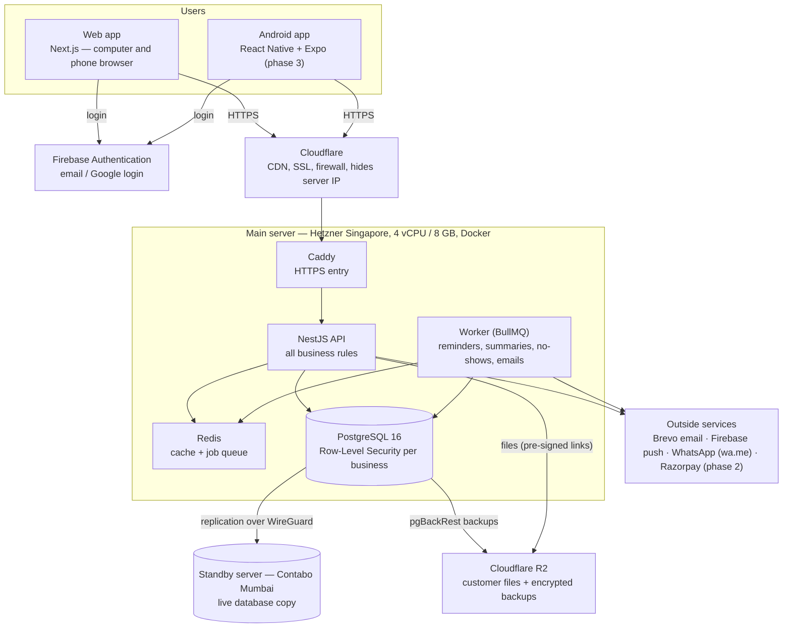

# 4. Architecture

**In one line:** the web app (and later the Android app) talks to one API on one main server; the database is
copied live to a standby server in Mumbai and backed up, encrypted, to Cloudflare R2.

## The big picture

If the Mermaid diagram doesn't render in your viewer, the same picture is in the Claude Doc plan.

## The parts

| Part | Job | Code folder |
|---|---|---|
| Web app | Every screen: landing page, sign-up, setup, CRM, settings | `vbw-crm/apps/web` |
| Android app | Daily use on the phone: calls, WhatsApp, photos, check-in (phase 3) | `vbw-crm/apps/mobile` |
| API | Checks the login, enforces rules (2 people, device limit, plan active), reads and writes data | `vbw-crm/apps/api/src/modules` |
| Worker | Runs scheduled jobs (list below) | `vbw-crm/apps/api/src/jobs` |
| Shared core | Industry templates, prices, limits, helpers used by all apps | `vbw-crm/packages/core` |
| Database | All business data, one database for all customers, separated by Row-Level Security | `vbw-crm/apps/api/src/db/migrations` |
| Server setup | Docker, backups, standby, firewall, deploy scripts | `vbw-crm/infra` |

## How a request flows (example: receptionist books an appointment)

1. The web app gets a fresh login token from Firebase.
2. It calls `POST /api/v1/appointments` through Cloudflare → Caddy → API, with the token and its device id.
3. The API checks: valid token → person exists → this device is still allowed → plan is active.
4. The API opens a database transaction that can **only see this business's rows** (Row-Level Security).
5. It saves the appointment and a history entry, then answers the web app.
6. One hour before the appointment, the worker sends a push reminder to the staff member.

## How each business's data is kept separate

- Every table has a `business_id`.
- The API connects to PostgreSQL as a special role (`vbw_app`) that **cannot bypass** Row-Level Security.
- Each request sets "current business" inside its transaction; the database itself hides all other businesses' rows.
- This is tested automatically: a second business gets "not found" for the first business's records.

## Database tables (summary)

| Table | Holds |
|---|---|
| businesses | Name, industry, plan status, trial end, paid-until, storage used |
| users | The 2 people per business, role (owner/member), Firebase id |
| invites, devices | Partner invites; logged-in phone/browser per person |
| industry_templates | The 3 templates (stages, fields, messages, dashboard) |
| pipeline_stages | Each business's stages |
| contacts | Patients / members / students |
| appointments, renewals, tasks | Scheduling and follow-ups |
| activities | History timeline per contact |
| message_templates | Each business's WhatsApp messages |
| payment_links | Razorpay links (phase 2) |
| files | Uploaded files (stored in R2) |
| audit_log | Who changed what |
| webhook_events | Razorpay events already processed |

## Background jobs (worker)

| Job | When (Indian time) |
|---|---|
| Morning summary push | 8:00 AM daily |
| Appointment reminder to staff | Every 5 minutes (1 hour before) |
| Renewal / follow-up alerts | 9:00 AM daily |
| Task reminders | Every minute |
| Mark no-shows | 11:30 PM daily |
| Trial / plan ending emails; expire ended plans | 10:00 AM daily |
| Remove unfinished uploads | 3:00 AM daily |

## API areas (all under `/api/v1`)

| Area | Main endpoints |
|---|---|
| Account | `auth/signup`, `auth/password-reset`, `auth/devices`, `me`, `setup/*`, `settings/business`, `team/*`, `audit` |
| Contacts | `contacts`, `contacts/:id`, `contacts/:id/stage`, `contacts/:id/activities`, `contacts/:id/merge`, `pipeline`, `import/*`, `export` |
| Schedule | `appointments`, `renewals`, `tasks` |
| Messaging | `message-templates`, `whatsapp/link` |
| Files | `files/upload-url`, `files/:id/confirm`, `files/:id/download-url` |
| Dashboard | `dashboard` |
| Billing | `billing`, `billing/subscribe`, `payment-links`, `webhooks/razorpay` (phase 2) |
| Health | `health` |
